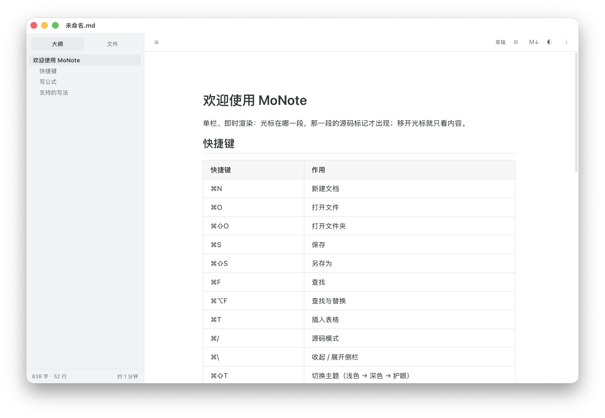
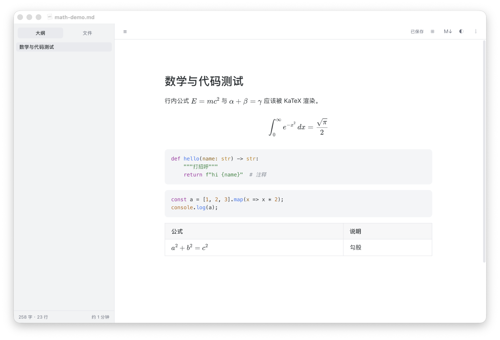

# MoNote

**一个 macOS 上的 Markdown 编辑器：单栏、即时渲染，3 MB，不依赖 Electron。**

*A 3 MB native macOS Markdown editor with instant rendering — AppKit shell + WKWebView core, no Electron, no npm.*



写完 `**粗体**` 松开键盘，星号就消失了；光标点回那段文字，星号又出现。没有左右分栏，也没有"预览"按钮。



---

## 特性

- **即时渲染**：语法符号平时隐藏，光标进入哪一段（或哪一处内联样式）才显形，移开即隐藏
- **数学公式**：行内 `$…$` 与行间 `$$…$$`，KaTeX 排版；点进公式就露出源码，改完再变回排版
- **代码高亮**：highlight.js 11.9，40+ 语言，未知语言回落内置规则
- **表格 / 列表 / 引用 / 提示框 / 脚注 / 目录 / front matter**：全部按 GFM 渲染
- **侧栏**：大纲（滚动联动高亮）+ 文件树（懒加载展开），⌘⇧O 打开整个文件夹
- **查找替换**、**插入表格对话框**、**粘贴截图自动存到 `assets/`**、**源码模式**、**导出 HTML**、**打印成 PDF**
- **自动保存**：停止输入 1.2 秒落盘，标题栏圆点表示未保存
- **三套主题**：浅色 / 深色 / 护眼，纯 CSS 变量切换

## 安装

只需要 macOS 命令行工具（`xcode-select --install`），不需要 Xcode 工程，不需要 npm。

```bash
git clone https://github.com/rookie-buer/monote.git && cd monote
./build.sh                       # 产出 build/MoNote.app
cp -R build/MoNote.app ~/Applications/
xattr -dr com.apple.quarantine ~/Applications/MoNote.app   # 本地临时签名，去隔离标记
```

双击启动，或 `open -a MoNote 笔记.md`；也支持把 `.md` 拖进窗口。

## 快捷键

| 键 | 作用 | 键 | 作用 |
|---|---|---|---|
| ⌘N | 新建 | ⌘O | 打开文件 |
| ⌘⇧O | 打开文件夹 | ⌘S | 保存 |
| ⌘⇧S | 另存为 | ⌘F | 查找 |
| ⌘⌥F | 查找与替换 | ⌘T | 插入表格 |
| ⌘/ | 源码模式 | ⌘\ | 收起侧栏 |
| ⌘⇧T | 切换主题 | ⌘B / ⌘I / ⌘K | 加粗 / 斜体 / 链接 |
| ⌘E | 导出 HTML | ⌘P | 打印 |

编辑区：`Enter` 分段、`Shift+Enter` 段内换行、列表内 `Enter` 续项、空列表项 `Enter` 退出列表、
行首 `Backspace` 合并到上一段、`Tab` 缩进、`⌘Z / ⌘⇧Z` 撤销重做。

## 设计：让 DOM 与源码逐字符对齐

这是整个项目唯一重要的设计决定。

**不变量**：渲染后的 DOM 里，按顺序恰好包含源码的每一个字符。语法符号被包进
`.md-meta` / `.md-blockmeta`（默认 `display:none`），内容照常排版。

于是三件事都变成算术而不是富文本操作：

| 操作 | 实现 |
|---|---|
| 取源码 | 遍历文本节点拼字符串，跳过标了 `data-noraw` 的装饰节点（KaTeX 产物、高亮片段、勾选框、图片） |
| 改内容 | 读回整块源码 → 重新解析 → 重建该块 DOM → 按字符偏移把光标放回去 |
| 保存 | 每块源码 + 块间空行数 `data-nl`，直接拼回原文，**逐字节不变** |

光标进入某元素时只加一个类：`.md-expand`（显示该内联元素自己的符号）、`.md-focus`（显示块级符号），
CSS 负责其余。所以"所见即所得"和"保存不丢格式"能同时成立，也不需要两套渲染器。

```
web/js/parser.js   纯函数：Markdown → HTML 字符串，保证字符一一对应
web/js/editor.js   DOM 与光标：偏移映射、按键语义、撤销栈
web/js/app.js      文档生命周期、侧栏、查找替换、主题、原生桥
src/main.swift     AppKit 外壳：窗口、菜单、文件 IO、JS Bridge、图片落盘
```

原生与页面之间只有一条窄桥：页面 `postMessage({cmd})`，Swift 用 `JSONSerialization` 回投
`window.MoNote.<fn>(payload)`。文件句柄、对话框、打印全在 Swift 侧。

## 正确性怎么验证

- **字符级往返**：解析 → 渲染 → 读回，与原文逐字节比较。32,144 字符 / 244 块的真实文档往返一致（约 50 ms）
- **无界面自检**：`MONOTE_SELFTEST=<文件>` 启动 → 打开该文件 → 编辑 → 等 1.2 s 自动保存 → 读盘打印 `WRITTEN`，退出
- **欢迎页自检**：`MONOTE_WELCOME_PROBE=1` 打印块数、公式数、表格行数，用于回归
- **浏览器内核调试**：`web/index.html` 可独立在 Chrome 打开（无原生桥时用 localStorage 冒充后端），
  配合 CDP 的 `Input.insertText` / `Input.dispatchKeyEvent` 驱动真实输入

## 支持的 Markdown

标题（ATX / setext）、段落与软换行、引用、嵌套有序 / 无序 / 任务列表、围栏代码块、
GFM 表格（对齐）、分割线、YAML front matter、`[TOC]`、脚注、GitHub alerts
（`> [!NOTE]` 等）、链接（行内 / 引用式 / 自动链接）、图片（相对路径按文档目录解析）、
粗体 / 斜体 / 删除线 / 高亮 `==` / 上标 `^` / 行内代码 / 公式 / emoji。

## 已知限制

- 没有 mermaid / PlantUML 图表
- 列表项内部的块级语法（列表里的代码块、标题）按行内文本处理
- 原始 HTML 块按文本显示，不解析
- 没有 PDF 精确排版（用系统打印）、图片上传、拼写检查、多语言界面
- 只支持 macOS（AppKit + WKWebView）

## 目录结构

```
build.sh              编译 Swift + 打包 .app + 临时签名
icon.icns             图标（由 tools/makeicon.swift 生成）
src/main.swift        原生外壳
web/index.html        页面骨架
web/css/app.css       外壳 / 排版 / 三套主题 / hljs 配色
web/vendor/           KaTeX、highlight.js（离线内嵌，附各自 LICENSE）
web/js/               parser.js → editor.js → app.js
tools/                makeicon.swift、winlist.swift（窗口枚举，调试用）
docs/                 截图
```

## 第三方组件

KaTeX 0.16.4（MIT）、highlight.js 11.9.0（BSD-3-Clause），均为纯静态资源，许可证见
[THIRD_PARTY_NOTICES.md](THIRD_PARTY_NOTICES.md)。交互方式参考了 Typora 的即时渲染思路，
本仓库不含其任何代码、资源或字体。

## License

[MIT](LICENSE) © 2026 blockbuer
